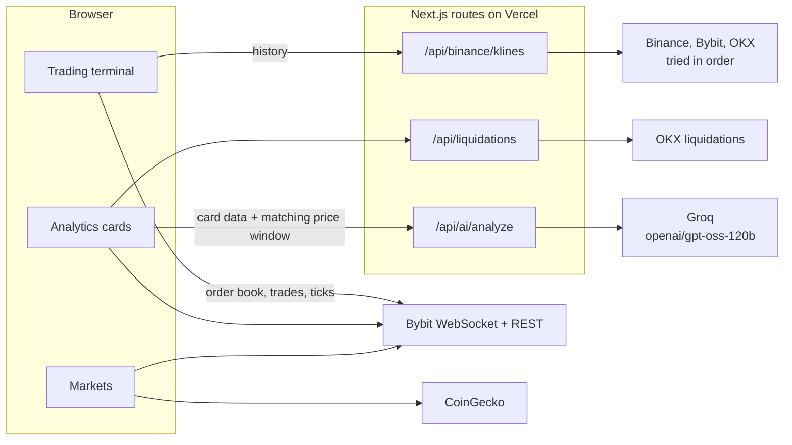
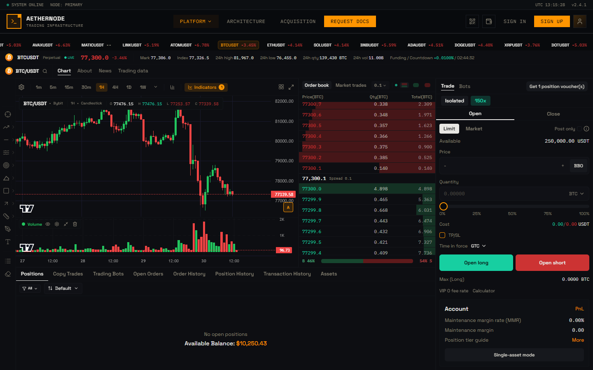
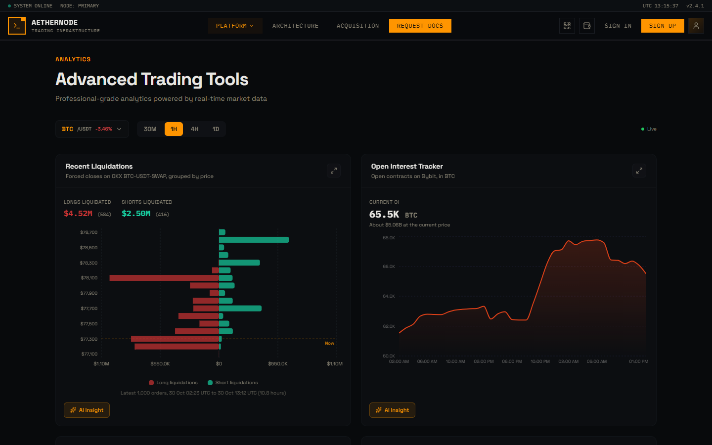
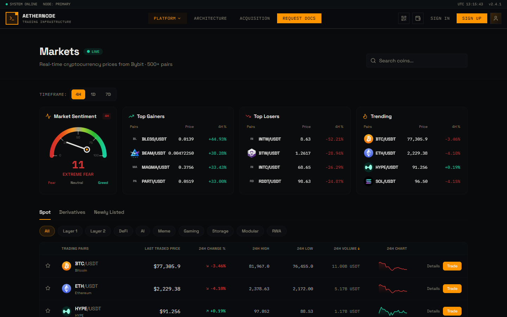
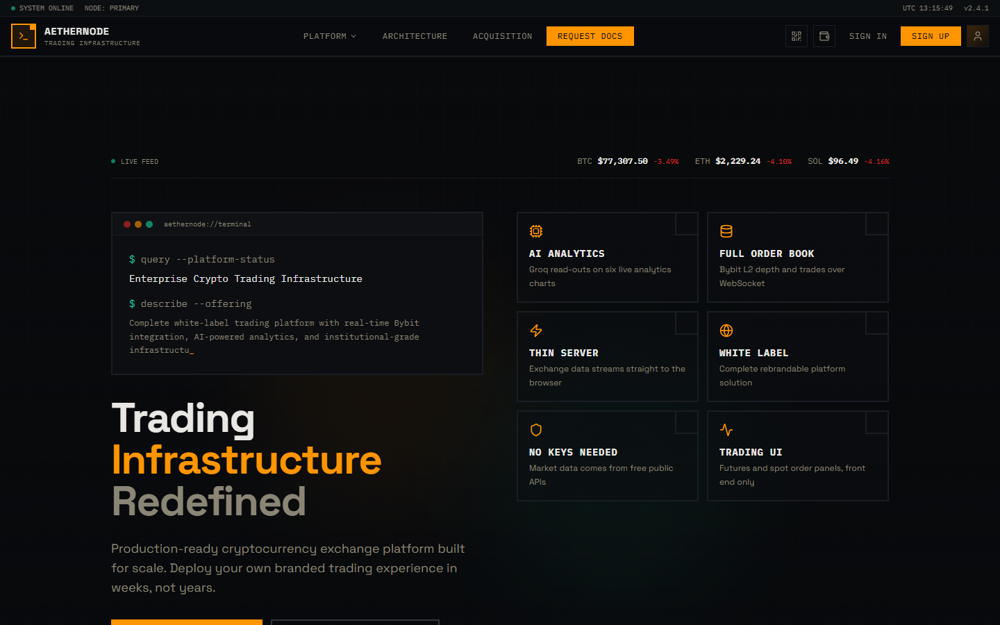

# AetherNode

A crypto trading terminal and analytics site built on free public exchange data, with an AI read-out on every analytics card. It streams live markets but doesn't place trades.

**Live:** [v0-searchable-analytics-menu.vercel.app](https://v0-searchable-analytics-menu.vercel.app) | **Built:** February to March 2026, reworked October 2026

## The idea

AetherNode is one of a few conceptual attempts at an architecture I wanted out of my head and running. Here the browser is the integration layer. Public exchange data streams straight into the page, and the server only does what the browser can't: keep the AI key private, fetch candle history when an exchange refuses, and read liquidations.

The second idea is AI grounded in what you're looking at. AI Insight sends a card's own numbers, the real time window they cover and the price over that same window, and the model has to talk about those numbers.

## How it works

The front end is Next.js 16, React 19, TypeScript, Tailwind, shadcn/ui, Lightweight Charts and Recharts.

- **Candles.** `/api/binance/klines` tries Binance spot and futures, Bybit spot and linear, then OKX, and normalises the first usable answer. Live candles stream over WebSocket. 32 indicators run in the browser.
- **Order book, trades and prices.** Bybit's public WebSocket and REST, straight from the browser.
- **Analytics.** Six cards on live data: liquidations from OKX through `/api/liquidations`, open interest, funding, long/short ratio and more from Bybit.
- **AI.** `/api/ai/analyze` adds a per-card instruction, trims long series, adds the price window that matches the data and asks `openai/gpt-oss-120b` on Groq for two or three sentences.
- **Markets.** Market cap, supply and 24h sparklines from CoinGecko.

There is no database, auth or scheduled job. The only secret is the Groq key.



## Status

Live and working as of 30 October 2026: the chart, order book, trades, markets, all six analytics cards and AI Insight. Trading, accounts and wallet connect are screens only, and the order buttons say so when pressed. A few template pages and tabs are labelled as placeholders.

## How I built it

I wrote the concept and spec and built the first version by directing v0, Vercel's AI app builder. When Binance refused the server I moved most data to Bybit in the browser and made the candle route a five-source fallback. In October 2026 I reworked it with Claude Code: real liquidations in place of random ones, open interest in the right unit, a current AI model given the true time window of its data, live prices where there were simulated ones, honest site copy and type errors no longer ignored at build time. I don't hand-write the code.

## Screenshots









## Run it locally

```bash
pnpm install
pnpm dev
```

Open http://localhost:3000. Only AI Insight needs a key: copy `.env.example` to `.env.local` and set `GROQ_API_KEY`. Use pnpm, since npm hits a peer dependency conflict. If Turbopack won't start, use `pnpm exec next dev --webpack`. The Formspree form id is masked in this copy, so the contact forms won't send until you add your own.

This repository is a snapshot of the code as of 2026-10-29. The working repository is private.
